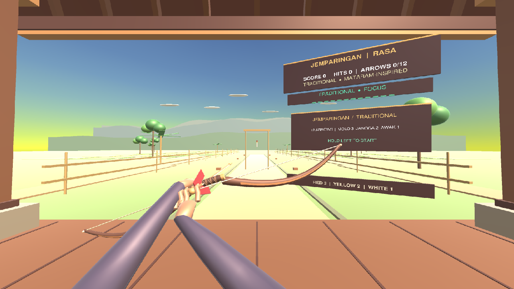
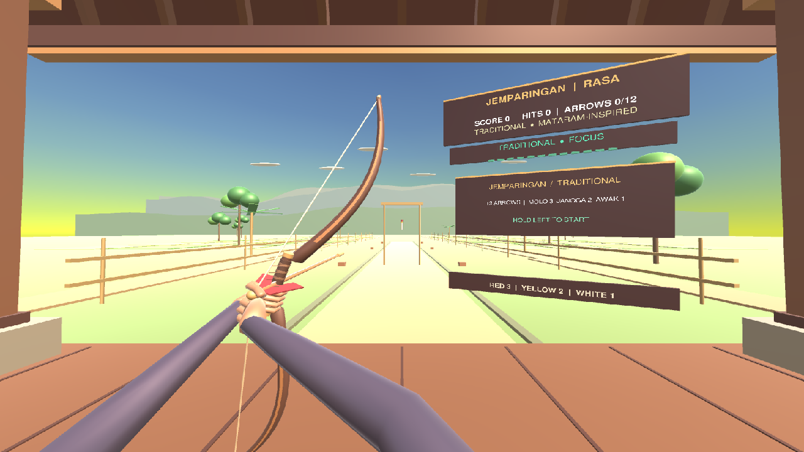
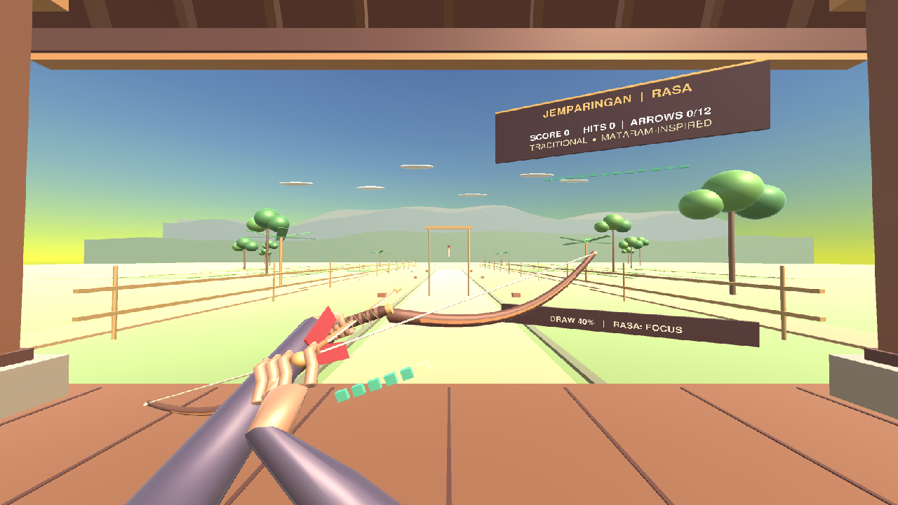
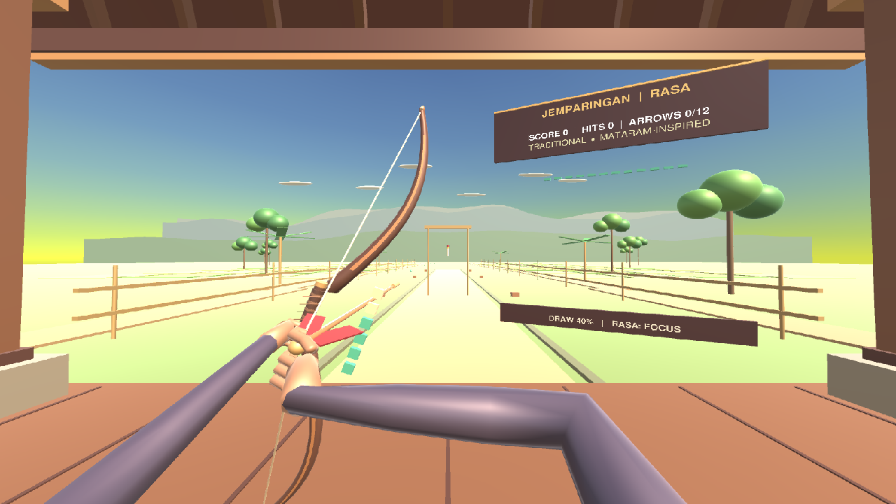
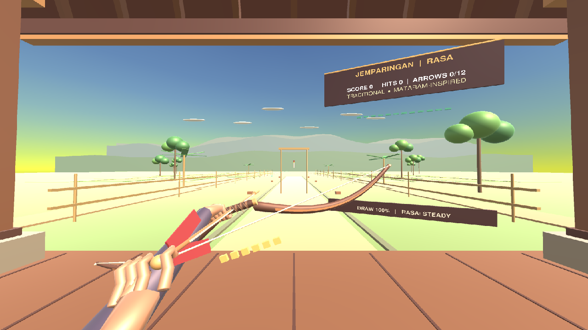
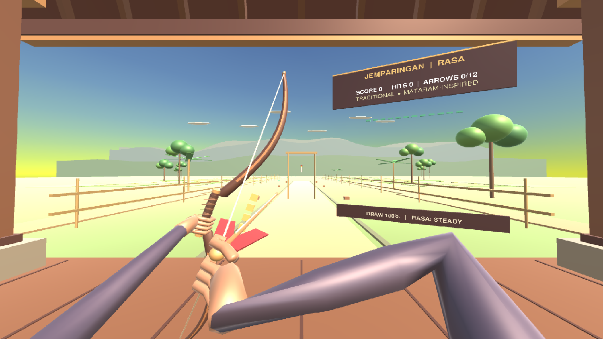

# Traditional aiming and body alignment v3 validation

Validated in Unity 6000.2.14f1 through the live Unity Pipeline connection on
`JemparinganPlayableEnvironment_v05.unity`.

The active scene was confirmed as
`Assets/Jemparingan/Scenes/JemparinganPlayableEnvironment_v05.unity` (loaded,
active, clean). The live camera was `Player viewpoint | seated 1.35m` at
`(0.000, 1.350, 1.250)`, rotation `(358.625, 0.000, 0.000)`, FOV `84°`. The
scene-specific FOV was retained because the final Game View kept the bandulan
clear while preserving useful peripheral context.

## Root causes

- The Traditional gandewa was rolled `-70°`, placing most of the limb and
  string across the target sightline.
- The desktop visual bow was derived by stacking offsets onto the gameplay
  pose, while the seated torso lived in a separate world-space frame.
- The string nock moved only along bow-local Z, so the draw hand never moved
  from the grip line toward the player's facial anchor side.
- Downward elbow bend hints made both sleeves fall out of the lower corners of
  the view, despite the hand contacts themselves being numerically correct.
- Sleeve radii were too large at first-person distance.

## Final live checks

- Traditional idle, half draw and full draw: both hand-contact errors `0 m`.
- Two-bone chains: left/right upper arms `0.36 m`; forearms `0.34 m`.
- Release: exactly one shot (`shots: 1`), with the normal gameplay release path.
- Traditional: 12 arrows, target sway/speed `0/0`.
- Camera yaw `-20°/+20°`: seat root remained at yaw `0°`; contacts stayed at
  `0 m`; no bone stretching.
- Classic switch: body hidden, 16 arrows, Classic target active, sway `0.06`,
  speed `0.7`.
- Existing **Gameplay QA v0.9**: `PASSED (39 deterministic rule/hitbox checks)`.
- Final compilation: completed, no compiler errors.
- Final Console ground truth: `0 errors`, `0 warnings`.

The Game View did not receive Linux XTest mouse-button events. Half/full draw
captures therefore use the validation-only `IJemparinganInput` adapter in
`Tools/TraditionalArmsValidation.cs`; it feeds deterministic poses through the
normal `JemparinganGame.Update` path. The real bow, string, cosmetic arrow,
hand targets and IK are updated by production code. It does not set score,
shot count, bow transforms or arm transforms directly.

## Screenshots

| State | Before | Final |
| --- | --- | --- |
| Idle |  |  |
| Half draw |  |  |
| Full draw |  |  |

Additional final captures:

- [Immediately after release](final-after-release.png)
- [Camera yaw left](final-look-left.png)
- [Camera yaw right](final-look-right.png)
- [Cross-legged posture at 45° downward pitch](final-seated-posture.png)
- [Classic Mode at the neutral camera angle](final-classic-neutral.png)

## Remaining limitation

The existing procedural torso and sarong are intentionally low-poly. At an
extreme 45° downward pitch they still look chunky and occupy much of the view;
at the normal aiming pitch they remain below the target and do not obstruct
the bandulan. Replacing that body with a purpose-built skinned mesh would be a
separate art pass.
